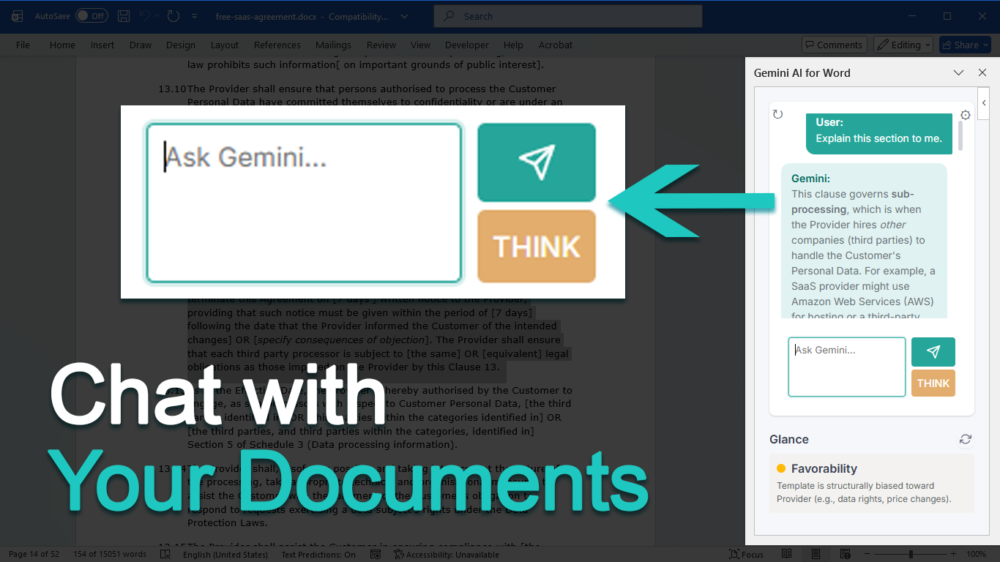

# Gemini AI for Office - AI Assistant for Microsoft Word

**✨ Available on the Microsoft Marketplace:** [Download Here](https://marketplace.microsoft.com/en-ca/product/saas/wa200009707)



## Quick Start

1. **Install** — Get the add-in from the [Microsoft Marketplace](https://marketplace.microsoft.com/en-ca/product/saas/wa200009707) (free)
2. **Add your API key** — Click the ⚙️ icon and enter your [Google Gemini API key](https://makersuite.google.com/app/apikey)
3. **Start chatting** — Ask the AI to summarize, edit, or review your document!

---

Gemini AI for Office integrates Google Gemini AI to draft, edit, and review your document directly. Unlock the power of Google's Gemini AI directly inside Microsoft Word.

Gemini AI for Office helps with precise wording, review and ordinary professional document changes using your own Google API key.

## Key Features

### Bring Your Own Key (BYOK)
Connect your Google AI Studio key and pay Google directly for API usage. The
key is stored in browser `localStorage`, and document context sent with a
request is processed by Google's API; see [Security Notes](#security-notes).

### AI Chat Assistant
Chat naturally with your document. Ask for summaries, clarifications, or rewrites using the latest Gemini models from Google.

### Direct Document Editing
Inspect focused document text, then apply one source-bound batch of concrete
changes through `docx-redline-js`. The Word plugin supports text corrections,
clause rewrites, plain paragraph insertion/deletion, comments, basic inline
emphasis, narrow same-level list insertion and table-cell text. Unsupported
structure, fonts, layout, research and revision acceptance are refused. Native
Word editing fallbacks and secondary AI interpretation are retired.
### Automated "Glance" Checks
Set up custom criteria—like "Check for Grammar" or "Verify Factual Accuracy"—and get an instant analysis every time you open a document.

### Custom Personas
Tailor the AI's personality and expertise. Make it a helpful tutor, a strict legal editor, or a creative writing coach.

### Safety & Versioning
Each new edit requires a saved body checkpoint. Revert restores that transported body package; it is not a complete-document backup.
Existing comments and pending revisions do not by themselves prevent ordinary editing. Comment additions preserve prior comments and threads; revision-aware edits respect the tracked-edit setting and preserve other reviewers' review marks. Specific unsupported shapes still refuse before writing.

Transform how you write today with Gemini AI for Office.

## Installation

### For Users (Recommended)
Simply get the add-in from the **[Microsoft Marketplace](https://marketplace.microsoft.com/en-ca/product/saas/wa200009707)** for an easy one-click free download.

### For Developers (Build from Source)
Follow these steps if you want to modify the code or run it locally.

#### Prerequisites

- Node.js (v14 or higher)
- npm or yarn
- Microsoft Word (Desktop version recommended)
- Google Gemini API key ([Get one here](https://makersuite.google.com/app/apikey))

#### Setup Steps

1. **Clone the repository**
   ```bash
   git clone <your-repo-url>
   cd AIWordPlugin
   ```

2. **Install dependencies**
   ```bash
   npm install
   ```

3. **Trust the development certificate**
   ```bash
   npx office-addin-dev-certs install
   ```

## Running the Add-in

1. **Start the development server**
   ```bash
   npm start
   ```
   
   This will:
   - Build the add-in
   - Start a local HTTPS server on port 3000
   - Open Word and sideload the add-in

2. **After making code changes**
   - Stop the server (Ctrl+C)
   - Rebuild: `npm run build:dev`
   - Restart: `npm start`
   - Refresh the task pane in Word (close and reopen it)

3. **Manual sideloading (if needed)**
   - In Word, go to Insert > Add-ins > My Add-ins
   - Click "Upload My Add-in"
   - Select the `manifest.xml` file from the project root

## Usage

### Setting Up Your API Key

1. Click the ⚙️ (gear) icon in the top right
2. Enter your Google Gemini API key
3. Click "Save"
4. The key is stored in your browser's localStorage

### Using the Chat Interface

1. Type your question in the chat input box
2. Press Enter or click "Send"
3. Wait for Gemini's response
4. Continue the conversation as needed

**Example questions:**
- "Summarize the key terms of this contract"
- "What are the termination clauses?"
- "Explain the liability section"

### Using the Redline Tool

1. (Optional) Select text in your document for context
2. Enter your editing instruction in the "AI Redline Tool" section
3. Click "Apply Changes as Redlines"
4. The AI will analyze the document and apply changes with track changes enabled

**Tips:**
- Be specific in your instructions
- The AI analyzes the entire document, not just selected text
- Review all changes before accepting them
- The library authors tracked changes; the Word adapter preserves the prior host tracking mode.

### Managing Checkpoints

Before a new atomic edit batch writes, the add-in saves its exact source body Flat OPC checkpoint in IndexedDB. If persistence fails, the edit is refused.

**How checkpoints work:**
- One exact-source checkpoint precedes each actual batch write. Verified no-ops do not create checkpoints.
- Checkpoints are stored in the browser's **IndexedDB** (not localStorage), so they are not limited by the ~5MB localStorage quota and can hold large documents.
- The most recent 10 checkpoints are kept; older ones are evicted automatically.

**Revert a change:**
- Click the **Revert** button attached to an AI edit message to restore the document to the state just before that edit.

## Best Practices & Personas

Get the most out of Gemini AI by tailoring it to your specific needs. Here are some optimized setups for different workflows:

### Legal Professional
**System Message:**
> You are assisting an in-house lawyer at AnsonCorp. You will mainly be working on legal documents. You must be specific, precise, and double-check all your advice and suggested changes. Maintain a professional and helpful tone. Be proactive in suggesting and brainstorming.

**Glance Settings:**
- **Summary:** "Please give me a one sentence summary of this document."
- **Favorability:** "Does this contract favor my client or its affiliates? If neutral, leave green."
- **Red Flags:** "Identify any high-risk clauses or unusual terms."

### Student & Academic
**System Message:**
> You are an academic writing tutor. Help me improve my detailed arguments and clarity without writing the essay for me. Focus on structure, thesis strength, and proper tone. Ensure I avoid passive voice where possible.

**Glance Settings:**
- **Thesis Check:** "Does the introduction clearly state a strong thesis?"
- **Clarity:** "Are there any overly complex sentences that should be simplified?"
- **Passive Voice:** "Flag any excessive use of passive voice."

### Creative Writer
**System Message:**
> You are a creative writing coach. Assist with character development, "show, don't tell," and pacing. Do not rewrite my style, but offer suggestions to make descriptions more vivid and dialogue more natural.

**Glance Settings:**
- **Adverb Check:** "Am I overusing adverbs? Point out weak verbs relying on adverbs."
- **Dialogue:** "Does the dialogue sound natural and distinct for each character?"
- **Pacing:** "Is the pacing of this chapter consistent?"

### Business Professional
**System Message:**
> You are a senior executive assistant. You edit for brevity, impact, and actionability. Remove fluff and corporate jargon. Ensure the bottom line (BLUF) is clear.

**Glance Settings:**
- **TL;DR:** "Provide a one sentence executive summary."
- **Action Items:** "Extract all clear action items and deadlines."
- **Tone:** "Is the tone confident and professional?"

## Project Structure

```
AIWordPlugin/
├── src/
│   ├── taskpane/
│   │   ├── taskpane.html              # Main UI
│   │   ├── taskpane.js                # UI, host context, settings and checkpoints
│   │   ├── taskpane.css               # Styling
│   │   └── modules/
│   │       ├── chat/                  # Inspect/apply harness, typed compiler, UI and history
│   │       ├── config/                # Per-model profiles (model-profiles.js)
│   │       ├── storage/               # IndexedDB checkpoint store
│   │       ├── utils/                 # Lazy module loading
│   │       └── docx-redline-js-integration/
│   │           ├── consumer-core.js    # Portable preparation and package helpers
│   │           └── word-operation-runner.js  # Word I/O and atomic batch adapter
│   └── commands/
│       ├── commands.html
│       └── commands.js
├── browser-demo/                      # Browser runtime for manual validation
├── mcp/docx-server/                   # MCP server exposing reconciliation tools
├── tests/                             # Node regression tests (*.mjs) + evals/ harness
├── docs/plans/                        # Active implementation plans
│   ├── completed/                     # Archived completed plans
│   └── migrated/                      # Superseded plans mapped to current plans
├── assets/                            # Icons
├── manifest.xml                       # Add-in manifest
├── package.json
├── webpack.config.js
└── README.md
```

> The add-in and MCP pin [`@ansonlai/docx-redline-js@0.8.4`](https://www.npmjs.com/package/@ansonlai/docx-redline-js). The library owns supported DOCX operations and package lifecycle; local consumers retain tool-to-operation mapping, host I/O, and their UI/session contracts. The Word consumer also retains its Flat OPC bridge and Office.js adapter; browser and MCP editing use the public package facade. See [`ARCHITECTURE.md`](ARCHITECTURE.md) for the system map and [the library offload review](docs/library-offload-review.md) for the file-by-file boundary.

## Development

### Building for Production

```bash
npm run build
```

### Linting

```bash
npm run lint
npm run lint:fix
```

### Debugging

- Use browser DevTools (F12) in the task pane
- Check the console for error messages
- Enable verbose logging in `taskpane.js` if needed

### DOCX XML Harness (Testing)

For package-level debugging (without opening Word), use the XML harness:

```powershell
npm run docx:harness -- -Action summary -InputPath "tests/Sample NDA.docx" -AsJson
```

You can also list parts, grep XML, run XPath queries, and extract the package:

```powershell
npm run docx:harness -- -Action list -InputPath "tests/Sample NDA.docx"
npm run docx:harness -- -Action grep -InputPath "tests/Sample NDA.docx" -Pattern "<w:numPr>"
npm run docx:harness -- -Action query -InputPath "tests/Sample NDA.docx" -Part "word/numbering.xml" -XPath "//w:num"
```

See `tests/docx-harness/README.md` for full usage.

### Regression Tests

Tests live in `tests/` as `.mjs` files and run directly with Node (no Word required):

```bash
node tests/<name>.mjs
```

**Direct-tool reliability and Word fidelity:**

```powershell
npm test
node tests/document_agent_loop_tests.mjs
node tests/document_edit_intents_tests.mjs
node tests/document_tools_tests.mjs
node tests/document_inspection_session_tests.mjs
node tests/word_source_identity_tests.mjs
node tests/checkpoint_restoration_tests.mjs
node tests/direct_document_fidelity_manifest_tests.mjs
```

The [tool contract](docs/agentic-tool-contracts.md) defines the two tools and
retained/refused actions. The [implementation plan](docs/plans/2026-10-02-library-first-lightweight-agent-reliability.md)
links each milestone's evidence. Actual Office.js exports and independent Word
save/reopen/Accept All/Reject All checks remain separate from offline mocks;
see [runnable host commands](scripts/README.md). The Word-authored list fixture
preserves source numbering continuation/restart and formatting sentinels.
Dated native-route reports remain historical evidence for retired capabilities.
Live fast/slow models must pass before shipping the changed prompt. Desktop
validation does not certify Word Online.
### Portable preparation and browser document sessions

The local Flat OPC bridge prepares one atomic library batch and preserves
transported parts. Word APIs read/insert body OOXML and preserve tracking state.
No complete-DOCX Word facade upgrade or binary bridge is planned. Browser and
MCP consumers continue using the library's complete-DOCX session facade;
JSZip remains in browser preview. See [ARCHITECTURE.md](ARCHITECTURE.md) and
[package boundaries](docs/package-boundaries.md).
### OOXML performance measurements

`npm run benchmark:ooxml` profiles supported workloads on the pinned library,
with raw samples and separate mapping/core/package timings. Actual Word
transport and taskpane startup have dedicated local profiling lanes; see
[measurement instructions](docs/ooxml-performance.md). These observations do
not replace fidelity tests or impose a universal timing threshold.

### Live model validation

The direct [NDA taskpane gate](scripts/README.md) replaces the retired secondary
redline-schema eval. It checks actual provider proposals, intended edits,
refusals, turns and host commits through the production two-tool harness.
Running it requires an environment API key and incurs provider usage. Both
supported configured fast/slow profiles must pass before shipping the changed
prompt; offline replay is separate evidence.
The add-in uses Google Gemini models. Users pick the **fast** and **think** (slow) models in Settings; the selection is saved per type. When nothing is selected, [`taskpane.js`](src/taskpane/taskpane.js) falls back to `gemini-flash-latest` (fast) and `gemini-2.5-pro` (slow):

```javascript
// In taskpane.js, loadModel returns the user's saved choice or a default:
function loadModel(type = 'fast') {
  const key = type === 'slow' ? "geminiModelSlow" : "geminiModelFast";
  const storedModel = localStorage.getItem(key);
  if (storedModel && storedModel.trim() !== "") {
    return storedModel;
  }
  return type === 'slow' ? "gemini-2.5-pro" : "gemini-flash-latest";
}
```

Per-model behavior (token limits, retries, preview-throttle warnings) is centralized in [`src/taskpane/modules/config/model-profiles.js`](src/taskpane/modules/config/model-profiles.js); add a profile there when introducing a new model.

## Deployment to Azure

### 1. Build the Production Bundle
Run the production build script to compile the assets and replace local URLs in `manifest.xml` with your production Azure URL:

```bash
# Using the configured Azure Storage default URL:
npm run build:prod

# OR with a custom Azure Static Web App / custom domain URL:
npm run build -- --env urlProd=https://<your-app-name>.azurestaticapps.net/
```
*(Ensure the URL has a trailing slash `/`)*

This compiles all files and the production-ready `manifest.xml` into the `dist/` directory.

Deploy the entire `dist/` output, including the content-hashed JavaScript chunks.
Editing modules load on first use; publishing only `taskpane.js` leaves those
modules unavailable. See [performance measurements](docs/ooxml-performance.md)
for startup and first-use observations.

### 2. Deploy from VS Code (Right-Click)

#### Option A: Azure Storage Static Website (for `*.web.core.windows.net`)
1. Install the **Azure Storage** extension in VS Code (`ms-azuretools.vscode-azurestorage`).
2. In the VS Code File Explorer, right-click the **`dist`** folder.
3. Select **"Deploy to Static Website via Azure Storage..."**.
4. Choose your Azure subscription and Storage Account (e.g., `stgeminiforword`).

#### Option B: Azure Static Web Apps (SWA)
1. Install the **Azure Static Web Apps** extension in VS Code (`ms-azuretools.vscode-azurestaticwebapps`).
2. In the VS Code File Explorer, right-click the **`dist`** folder.
3. Select **"Deploy to Static Web App..."**.

---

### 3. Sideload / Deploy the Manifest

After deploying the web assets, upload the generated `dist/manifest.xml`:
- **Word Desktop / Web (Individual Sideload):** Open Word &rarr; **Home** &rarr; **Add-ins** &rarr; **More Add-ins** &rarr; **Upload My Add-in** &rarr; select `dist/manifest.xml`.
- **Organization-Wide (M365 Admin Center):** Go to [Microsoft 365 Admin Center](https://admin.microsoft.com/) &rarr; **Settings** &rarr; **Integrated apps** &rarr; **Upload custom apps** &rarr; select `dist/manifest.xml`.

## Security Notes

⚠️ **Important Security Considerations:**

1. **API keys in localStorage** - Keys are stored in browser storage (not encrypted)
2. **Production deployment** - Use environment variables or secure key management
3. **HTTPS required** - Office Add-ins require HTTPS in production

## Troubleshooting

### Add-in won't load
- Ensure the dev server is running (`npm start`)
- Check that port 3000 is not in use
- Verify the certificate is trusted
- Try clearing Office cache: `npx office-addin-dev-settings clear`

### API errors
- Verify your API key is correct
- Check your Gemini API quota
- Ensure you have internet connectivity
- Check browser console for detailed error messages

### Track changes not working
- Ensure you have edit permissions on the document
- Try manually enabling Track Changes in Word
- Check that the document isn't protected

### Checkpoints not saving
- Ensure you have a valid document open
- Checkpoints are stored in the browser's IndexedDB; make sure it isn't disabled (e.g. some private-browsing modes) or out of disk space
- A failed checkpoint blocks a new edit. Resolve storage availability and inspect again before retrying.

## Reliability direction

Keep ordinary professional edits dependable through a small tool set, strong
source targeting, atomic batches, preserved formatting and clear refusals.
Broader structural editing, font/layout controls, general skills and additional
harness dependencies are outside the approved scope.
## Contributing

Contributions are welcome! Please:
1. Fork the repository
2. Create a feature branch
3. Make your changes
4. Submit a pull request

## License

MIT License - See LICENSE file for details

## Support

For issues and questions:
- Check the [Troubleshooting](#troubleshooting) section
- Review [Office Add-ins documentation](https://docs.microsoft.com/en-us/office/dev/add-ins/)
- Check [Google Gemini API docs](https://ai.google.dev/docs)

## Acknowledgments

- Built with [Yeoman Office Add-in generator](https://github.com/OfficeDev/generator-office)
- Powered by [Google Gemini AI](https://deepmind.google/technologies/gemini/)
- Uses [Office.js API](https://docs.microsoft.com/en-us/office/dev/add-ins/reference/javascript-api-for-office)
