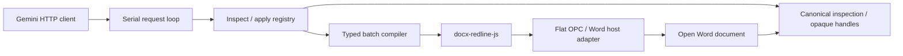

# System architecture

The Word plugin uses two document tools, `inspect_document` and
`apply_document_edits`, plus `search_web` for facts the document does not
contain. A small serial harness lets Gemini propose concrete source-bound
edits. `@ansonlai/docx-redline-js@0.11.1` (exact pin in the single root
`package.json`) owns the transformations; Office.js transports the current Word
body and preserves host state.

| Module | Responsibility |
| --- | --- |
| `taskpane.js` | UI, settings, request cancellation, host identity, lazy module loading and IndexedDB checkpoints. |
| `document-agent-loop.js` | Complete provider/tool exchanges, six-turn budget, two failed mutation cycles, one proven no-write stale refresh, terminal outcomes and UI events. |
| `request-outcome.js` | What a finished or cancelled request left behind (an edit written or attempted), the landed-edit note and the bounded wait before a refresh clears the chat. |
| `settings-save.js` | Save-on-change for the API key, models and system prompt, with validation; an empty key removes it. |
| `tool-registry.js` | The three declarations (`inspect_document`, `apply_document_edits`, `search_web`), dispatch, validation, progress and completion evidence. |
| `web-search.js` | The `search_web` executor: a separate grounded Gemini request that returns a short answer with sources, labelled as reference material rather than instructions. |
| `document-editing-guide.js` | One compact versioned workflow; owner persona affects drafting, never execution guarantees. |
| `document-inspection-session.js` | Bounded canonical results and opaque handles/cursors; private strong descriptors bind to document, revision view and all captured parts. |
| `document-edit-intents.js` | All-intent validation and mapping to public library operations, without Word APIs or secondary AI generation. |
| `document-tools.js` | Fresh source capture, compilation, preparation accounting, checkpoint persistence, final freshness guard, one host insertion and fresh verification. |
| `consumer-core.js` | Local Flat OPC inspection/preparation and package assembly around supported library operations and comment/numbering helpers. No host or provider globals. |
| `word-operation-runner.js`, `word-ooxml.js` | Body OOXML read/insert/sync, tracking-state restoration and truthful write observations. |
| `word-source-identity.js` | Derived source tokens ignore certified Word export-only session metadata, including the paragraph and table-row ids Word regenerates on re-insert. Real IDs, source/payload and meaningful revisions remain intact. |
| `checkpoint-restoration.js` | One body checkpoint replacement and verification, preserving tracking state even on errors. |

A mutation resolves every handle against one fresh immutable source. Truncated
inspection cannot authorize a full rewrite. All requested intents validate
before preparation; an unsupported mixed batch refuses in full. The engine
must account for all prepared operations. A valid no-op writes nothing. A new
write requires the exact pre-batch body checkpoint to persist and the source to
remain fresh. The adapter inserts one prepared Flat OPC body package, then
verifies current host text, structure, comments and requested emphasis.

Only one mutation call may appear in an exchange; combining it with another
call refuses the exchange before execution. Cancellation prevents queued
writes, while settled host evidence survives cancellation. A rejected or
unverified attempted write stops for inspection and is never replayed. Provider
retries repeat HTTP calls only. Handles expire after mutation or source change;
freshness checks cover Undo and external edits even without reliable events.

Office.js remains for initialization, reads, selection, content transport and
tracking. The agent has no native paragraph/list/table editing algorithm or
fallback, and no tool-internal model call for document edits. Supported list
actions are insertion, conversion of paragraphs to a list, numbering format
changes and continuing an earlier list. Unsupported table creation, font,
layout, list depth and revision-acceptance requests refuse. See the
[tool contract](agentic-tool-contracts.md) for the precise retained actions.

Flat OPC assembly remains consumer code; it was simplified locally rather than
claimed as a library offload. The owner excluded a complete-DOCX Word facade or
binary bridge. The browser demo and the local MCP server that once used the
library's complete-DOCX facade were removed from the repository on 2026-10-18;
the Word add-in is the only product surface.

The [dated implementation plan](plans/completed/2026-10-02-library-first-lightweight-agent-reliability.md)
and linked reports distinguish offline checks, real Office.js, independent Word
Accept All/Reject All, and taskpane replay. The lanes and their commands are in
[scripts/README.md](../scripts/README.md), including the scripted taskpane
checks for the request, refresh, Revert and Settings state machines. Live fast/slow provider checks remain
a shipping gate. Desktop evidence does not certify Word Online. Checkpoints
cover the transported body Flat OPC, rather than a complete-document backup.
