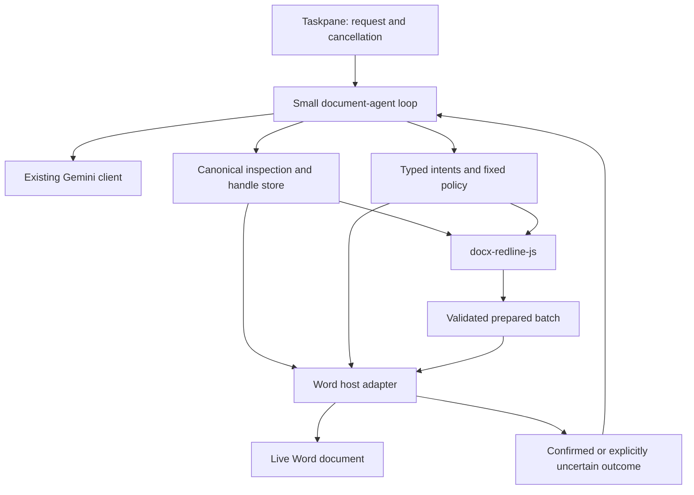

# Library-first editing and a lightweight document agent

**Date:** 2026-10-02 (America/Vancouver)  
**Status:** WP0–WP5 complete locally on 2026-10-02. Live provider and Word Online shipping gates remain explicit.
**Baseline:** Add-in release v2.2.0.0; exact `@ansonlai/docx-redline-js@0.8.4` in the add-in and MCP.  
**Purpose:** Make ordinary professional document changes dependable by reducing tool choices, competing execution paths, repeated AI interpretation, and Word-specific editing logic.

**Confirmed owner constraint:** Remove native Word editing commands, while keeping the product an in-place Word plugin. Office.js host transport/state integration remains necessary and in scope.

**Decision update (2026-10-02):** The owner accepted the recommended choices and explicitly confirmed a tighter harness without a general skill system, more refusals outside scope, batch-oriented changes, and retaining the existing Word transport instead of pursuing a complete-DOCX facade upgrade. The approved decisions below replace the earlier alternatives; this request does not start implementation.

**Execution update (2026-10-02):** The owner subsequently authorized WP0 and WP1 and requested Luna agents at max reasoning for efficient bounded delegation. This authorization superseded the earlier plan-only restriction for these two packages. The owner then authorized completing WP2–WP5, with a local commit after each milestone; WP0/WP1 were committed as `2c179a1`. Preserve current editing behavior during WP1; new tool protocol, batch policy cutover, native-route retirement, and checkpoint blocking belong to later packages.

## Execution status and handoff

| Package | Status | Current work / evidence |
| --- | --- | --- |
| WP0 | Complete | [Scope matrix, route inventory, and fresh baseline](../validation-reports/2026-10-02-lightweight-harness-wp0-baseline.md): 57 offline suites pass; 16/16 desktop replay steps complete, 29/29 content checks pass; three existing native-route author failures reproduced. Frozen bundle at `.cache/reliability/wp0-baseline/dist`. Office.js read/write counters unavailable. |
| WP1 | Complete | [Extraction, verification, and net-size report](../validation-reports/2026-10-02-lightweight-harness-wp1.md): 61 offline suites pass; development/production builds pass; completed desktop replay preserves 29/29 content checks, 43 local model requests, and the same three author failures. Request/controller/history races fixed; all executor algorithm bodies/signatures and 11 declarations preserved. Net production size: 8,632 → 8,633 lines (+1), across 24 → 27 files. |
| WP2 | Complete | [Canonical source and handle validation](../validation-reports/2026-10-02-lightweight-harness-wp2.md): 63 milestone offline suites pass; fresh desktop replay preserves 29/29 content checks, the same three author failures and 43 requests. Duplicate Word metadata/context walk removed. |
| WP3 | Complete locally | [Direct typed batch report](../validation-reports/2026-10-02-lightweight-harness-wp3.md): 66 milestone offline suites; full direct Word replay 16/16 prompts, 48/48 checks, zero regressions. Ten verified batches: nine writes + one no-op; 36 mocked chat calls, zero nested calls. Word export-only metadata stabilized without changing source/payload or meaningful revision IDs. Live models remain a shipping gate. |
| WP4 | Complete locally | [Native-route retirement and fidelity report](../validation-reports/2026-10-02-lightweight-harness-wp4.md): 11/11 actual Office.js cases, 44/44 independent Word checks, 49/49 NDA replay checks. Documented complete list-change preserves existing numbering. Net fixed production surface 7,004 lines, 1,628 fewer than WP0. |
| WP5 | Complete locally | [Final bridge, checkpoint and measurement report](../validation-reports/2026-10-02-lightweight-harness-wp5.md): 46 offline suites, 18 actual Office.js checks, 52/52 independent Word checks, 49/49 final NDA replay checks. Verified checkpoint restoration and two new prewrite scope guards. Fixed production surface: 4,355 lines, 49.5% below WP0. |

WP0/WP1 are committed locally as `2c179a1`, WP2 as `e8c9aaa`, WP3 as `d282255`, and WP4 as `86b6ddc`; WP5 is recorded by the final milestone commit containing this report. No deployment or push is requested. The WP0 bundle remains frozen at `.cache/reliability/wp0-baseline/dist`; the completed WP1 replay uses `.cache/reliability/wp1/completed-dist` and `golden-completed`. These artifacts are ignored and are not required to run the checked-in tests on another checkout. Historical baseline author failures remain documented; the final retained path passes attribution checks. Local completion does not certify the remaining shipping gates.

### Current continuation seam — implementation complete; external gates remain

Production has exactly two tools and no native editing executor or compatibility
command directory. `consumer-core.js` exports only `inspectWordSource` and
`prepareCanonicalBatch`; `word-operation-runner.js` retains the body-only
`executePureOoxmlBatch`. Flat OPC extraction/assembly preserves untouched
transported parts and calls public library comment/numbering helpers. The
library pin remains 0.8.4; no upstream offload or facade upgrade is claimed.

Checkpoint save now resolves on IndexedDB transaction completion, rather than
request success. The wired restore helper performs one replacement with tracking
preserved and compares the restored parts. Actual Word regenerated body
`w14:paraId` and `w14:textId`, including comment paragraph/link IDs; a separate
restoration comparison excludes only confirmed generated metadata while
requiring exact public canonical comment relationships, state, authors, dates,
text and anchors. Unknown metadata references refuse. Normal source tokens
retain real IDs, so old handles expire after restoration. Saved XML is untouched.
Successful restore resets the model and visible conversation together; missing,
failed or unverified restore preserves history and reports the outcome.

WP5 production thinning, live evidence capture, reproducers and documentation are
complete. The final direct NDA replay passed 16/16 steps and 49/49 checks;
production build and manifest validation pass. Actual Office.js passed 18 checks
over 11 main cases and checkpoint/refusal controls. Independent Word passed
52 checks, with 13 engine-reference checks explicitly not applicable. The final
offline aggregate passes 46 suites with three excluded entrypoints. The fixed
production surface is 4,355 lines across 20 files, down 4,277 lines (49.5%) from
WP0, including all replacement modules. Two isolated new-comment probes on a threaded source reported
uncertain host insertion with no replay. Both prior and thinned bridges had
treated merge-delta comment output as a full replacement. No supported complete
merge helper for the retained Word Flat OPC seam was found. Adding comments to any source with existing comments is
now refused as a whole before checkpoint/write; supported wording edits preserve
threads. This narrower scope is an authorized reliability restriction, rather
than a new native fallback or a claim that the library contract is defective.
An untracked rewrite of a paragraph with a prior revision flattened that
history in a fidelity probe. Such targets now refuse before any write;
supported edits elsewhere preserve the pending revision and restore it from
the checkpoint. The add-in's tracked-edit option is required for revised targets.
The [WP5 report](../validation-reports/2026-10-02-lightweight-harness-wp5.md)
records final totals, preserved failures, code measurements and reproduction paths.

Remaining shipping gates are live fast/slow provider proposals through the
runnable direct replay lane and affected Word Online operation checks. Desktop
evidence does not establish either. Independent upstream issue reproducers stay
runnable; retiring a consumer capability does not close an engine defect.

## Approved direction

Build around two document tools: **inspect the document** and **apply a batch of edits**. Conditional navigation/research retention was evaluated during cutover; both executors are retired in the final supported path. Let the model draft concrete edits against inspected targets; let the library perform document transformations; let a small Word adapter read, commit, and confirm the result.

Aim for **zero native Word editing algorithms in the supported editing path**, with Office.js confined to host transport and host state. The owner has confirmed that the product must remain a Word plugin. The existing browser/MCP consumers are useful comparison and parity lanes, rather than a replacement for editing the user's currently open Word document.

Start with text corrections, clause rewrites, paragraph insertion/deletion, and comments. Preserve existing formatting, numbering, comments, and other reviewers' revisions. Retain the current basic inline emphasis/removal operations within a narrow allowlist. Do not build a font, layout, or styling assistant.

Refuse requests outside the supported scope before writing. Retain everyday list text/insertion and table-cell text changes where the library supports them reliably; gate conversion, numbering-style/deep-list changes, and structural table changes on upstream capability and fidelity evidence. Do not maintain native editing fallbacks in the new path to satisfy unsupported requests. Existing routes may remain during staged cutover, but their removal or retirement is part of completion.

Apply independent changes as one fully validated atomic library batch against one source snapshot, with one host content commit. If any requested intent is unsupported or invalid, refuse the batch rather than silently apply a subset or split the request to bypass a refusal. A genuinely dependent later stage requires fresh inspection after a confirmed batch; this is not permission to return to per-edit writes.

The target is fewer ways to produce an incorrect document, not merely fewer function declarations. One enormous tool with a free-form instruction and many hidden branches would preserve the current complexity.

## What the planning baseline documentation and code established

Reviewed all six Markdown files at the `docs/` root: [tool contracts](../agentic-tool-contracts.md), [library offload review](../library-offload-review.md), [package boundaries](../package-boundaries.md), [performance notes](../ooxml-performance.md), [testing](../TESTING.md), and [historical PLAN](../PLAN.md). Also reviewed [v2.2.0.0](../release/v2.2.0.0.md), [architecture](../../ARCHITECTURE.md), current state/roadmap, the active list/table plans, the [0.8.4 validation](../validation-reports/2026-10-02-docx-redline-v084.md), library follow-ups, and the relevant taskpane/tool/context/adapter implementations.

The root `docs/PLAN.md` is a historical July draft with later migration notices. Its old counts, proposed modules, and execution instructions are not the current queue. This plan carries forward the relevant intent without reopening already completed reliability work.

| Finding | Reliability implication |
| --- | --- |
| `apply_redlines` already prepares an immutable-source atomic library batch and commits it through one Word OOXML insertion. | Extend this ownership pattern; avoid replacing a working engine boundary. |
| The taskpane currently declares **11 tools**: redlines, comments, highlights, research, navigation, four list/section tools, table editing, and selection statistics. | Tool choice and targeting contracts remain larger than this product needs. |
| Redline, comment, highlight, and navigation executors make additional AI calls after the chat model chooses the tool. Redline also has corrective generation. | A simple user instruction can pass through multiple interpreters, prompts, and failure budgets. |
| Comments/highlights use per-suggestion paragraph reads/writes. Table/section/header conversion still include direct Word edits. | One request can partly commit, and freshness/atomicity protections differ by route. |
| Word metadata extraction loads paragraph/list/table proxies, then a separate canonical source supplies the engine's text. Alignment can fall back to Word text. | There are still two document representations to reconcile. Pending deletions and soft breaks have already exposed this cost. |
| Tool outcomes differ: `showToUser`, `success`, library status, and host write evidence have distinct roles. | The loop should decide completion once from explicit evidence; presentation flags must not stand in for completion. |
| Provider transport, lazy loading, source guards, bounded history, two failed mutation cycles, and one no-write stale replan are already implemented. | Preserve these defenses while simplifying their callers. Do not rebuild them as new features. |

`format_text` is a generated change/operation path, not an additional top-level tool declaration. Its occurrence support in 0.8.4 is useful for narrow emphasis changes; it does not justify exposing the library's entire formatting surface.

The 0.8.4 report records 57 offline suites passing, four excluded entrypoints, suite-internal skips, and 29/29 final content checks in the 16-step desktop Word replay. Native paths still fail author checks on steps 6, 9, and 12. The live-model lane was not run. These are existing dated results, not new validation performed for this planning exercise.

### Current upstream constraints

The [library issue index](../library-issues/README.md) and [list migration follow-up](2026-09-30-canonical-list-migration-follow-up.md) identify constraints that remain relevant:

- Plain/text-changing header-to-list conversion and list-format changes do not yet have the required supported canonical behavior.
- Separate list operations in 0.8.4 can restart non-adjacent header numbering: A/A instead of A/B. The historical native conversion avoided this regression; conversion is now refused and that executor is deleted.
- Reject All after a tracked final table append can leave one extra blank paragraph.
- A weakly targeted soft-break replacement can delete a paragraph while reporting `ok`. Current strong add-in targets avoid the reported case; a new wrapper must retain that protection.
- Rewriting a paragraph with the author's own pending formatting and adding a table together remains refused by the consumer.

Do not count an operation type appearing in a schema as proof that every desired structure works. These defects need upstream fixes or explicit scope restrictions before migration. Continue the repository's [upstream ownership rule](../../.agent/rules/docx-redline-js-ownership.md): document engine defects with independent reproducers; do not implement consumer OOXML workarounds or edit installed package internals.

This plan coordinates with the two active plans rather than declaring them superseded. During implementation, adjust their retained scope and links to the approved decisions here. An intentional capability retirement must be recorded as a product decision, not marked as a completed migration. The initial decision update changed only this plan; WP1 subsequently updated the architecture, tool contracts, and package boundaries to describe the extracted harness.

## Lessons from the upstream skill and harness documentation

Primary library references are [Skill and Harness Authoring](https://github.com/AnsonLai/docx-redline-js/blob/master/docs/SKILL_AUTHORING.md), [Agent Fast Start](https://github.com/AnsonLai/docx-redline-js/blob/master/docs/AGENT_FAST_START.md), the [knowledge base](https://github.com/AnsonLai/docx-redline-js/blob/master/docs/AGENT_KNOWLEDGE_BASE.md), and the [agent-session example](https://github.com/AnsonLai/docx-redline-js/blob/master/examples/agent-session-wrapper.mjs).

The GitHub README/fast-start were accessible during research; the skill-authoring/raw requests did not return content through the web reader. Those files and the example were read from the clean sibling source checkout at `683c30a` (release 0.8.4), whose origin is `AnsonLai/docx-redline-js`. Treat those source documents as design guidance, and verify usable exports against the installed package. In particular, the example is development-only, uses Node imports/internal helpers, and is not a published browser or Word integration API.

### Adopt the interaction pattern

1. Inspect a focused clause/range with enough surrounding context.
2. Keep exact text, strong target descriptors, revision view, and source revision in the runtime.
3. Give the model a short opaque handle for each inspected target.
4. Accept complete desired text for a semantic rewrite, or localized replacements for a literal correction.
5. Apply one batch using strict targeting and explicit policies.
6. Return a compact completion result, human-readable locations, and actionable recovery information.

This can simplify both the tool schemas and the prompt. The model should not reconstruct paragraph IDs, calculate live Word indexes, choose package parts, or reason about tracking toggles.

The handle is an application-owned reference to an inspected target, not a new targeting engine. It must include the source/view identity internally and resolve to library-supported descriptors. Handles from another document, an expired snapshot, a different revision view, or a prior committed mutation must be rejected. New handles follow a fresh inspection of the actual host state.

Use the library's inspection filtering, matching, replacement semantics, and error recovery where available. Do not copy the example's search implementation, exact-patch compiler, or private imports into this application. If a required abstraction is missing, propose a small supported upstream API and keep the dependency explicit.

### Adapt the contract to live Word

The library's CLI success contract includes `completion: true` and a non-null `outputPath`. An in-place Word tool has no output file; fabricating an `outputPath` would be misleading. Its wrapper instead needs an explicit **complete host result**: all requested operations accounted for, engine preparation valid, host commit confirmed, and required verification passed.

Likewise, a cached `DocxDocument` revision is authoritative for its in-memory package, not for a live document being edited or undone in Word. A live source read/freshness check remains necessary. A handle layer must not turn a cache into an assumed lock.

The upstream CLI defaults to progressive edits, while the example profile and the existing add-in redline route use atomic batches. The approved Word policy is atomic preparation and all-intent proposal validation: do not quietly discard an invalid requested edit and report the rest as complete. Present partial outcomes accurately if a host failure makes them possible; they are exceptional host outcomes, not a selected progressive editing mode.

Use `error.recovery.action` and related fields when the installed integration surface supplies them. Keep Word transport failures in a small separate host taxonomy. An upstream retry suggestion cannot override evidence that a Word write was attempted or its result is uncertain.

Pin exact releases and negotiate only used capabilities. CLI contract 8 is relevant to a CLI integration; a browser/Word wrapper should check its actual required exports and behaviors rather than introduce a CLI process just to perform negotiation.

### Use one compact editing guide

Use one bundled, versioned instruction resource with the ordinary inspect/apply workflow. A focused structural appendix is permitted only if evidence shows it is needed for retained actions. Keep detailed library design knowledge out of every model turn. The owner persona remains an input for drafting style; it cannot change execution guarantees. A general skill discovery/loading system is explicitly excluded.

Pi's [skills documentation](https://github.com/earendil-works/pi/blob/main/packages/coding-agent/docs/skills.md) describes advertising short skill descriptions and loading fuller guidance when relevant. For this single-purpose product, use the disclosure principle without building a skill marketplace or another skill-loading tool. Start with one short always-available editing guide; add deterministic loading of a structural appendix only if evaluations show a need.

Essential rules belong in code: stale-handle refusal, supported action validation, no automatic revision acceptance, no unchanged failed replay, and completion checks. A prompt is drafting guidance, not enforcement.

## A lightweight harness inspired by Pi

[Pi](https://pi.dev/) and its [coding-agent documentation](https://github.com/earendil-works/pi/tree/main/packages/coding-agent) demonstrate a small default tool set. Its [agent core](https://github.com/earendil-works/pi/blob/main/packages/agent/README.md) separates context transformation, provider messages, tool execution, and lifecycle events. Those boundaries are useful here. The domain tools should be document-specific; copying a coding agent's shell/filesystem tools would enlarge this product's responsibilities.

| Approach considered | Benefit | Cost / uncertainty | Decision |
| --- | --- | --- | --- |
| Extract a small local loop around the existing Gemini client | Keeps proven provider/history behavior and allows Word-specific commit rules to remain direct | The application continues to maintain the loop | **Selected.** Tighten the existing harness and remove redundant orchestration. |
| Adopt Pi agent core after a focused compatibility experiment | Could remove generic loop/event/provider plumbing | Browser bundling, Gemini message fidelity, cancellation, dependencies, and stop behavior need proof | Not included in implementation. Pi informs the design; no new harness dependency or experiment is planned. |
| Embed the full coding-agent runtime | Broad extension/session facilities | Much more machinery than a two-tool document editor needs | Outside this plan. |

Do not assume a general-purpose harness provides document safety. Current Pi core documents parallel tool execution as the default and a termination hint that stops automatically only when every result in a batch terminates. These illustrate why the selected local harness must enforce sequential document execution and an unconditional stop after an uncertain write itself.

The local harness needs only a request lifecycle, a small registry, context construction, complete tool exchanges, explicit budgets, cancellation, and events for the existing UI/diagnostics. Avoid a plugin framework, session trees, subagents, general workflow graphs, background jobs, or automatic skill generation.

## Approved tool direction and retirement map

The two-tool design is approved. These names and exact schema shapes remain implementation proposals, not existing public APIs.

| Surface | Purpose | Boundary |
| --- | --- | --- |
| `inspect_document` | Search/read a focused range, surrounding paragraphs, comments, and revision cues; return source-bound handles | Read-only canonical library inspection. Selection is optional host input. Results are bounded and indicate omitted content/pagination. |
| `apply_document_edits` | Apply typed edit intents against returned handles in one source-bound batch | No extra AI call inside the tool. Library owns transformation; Word adapter owns commit/confirmation. |
| `navigate_to_target` (optional) | Select a previously inspected location | Host-only navigation; no secondary AI interpretation. |
| Research (optional, separate) | Existing explicit external lookup workflow | Disabled in the ordinary editing tool set; does not share a document mutation budget or promise document accuracy. |

Approved default: two tools, or three if existing navigation remains useful. Existing research may remain for explicit use, isolated from ordinary editing; at most four are exposed for that workflow. These conditional capabilities must earn their place through existing usage and scope, not new feature work. Summarization/review prose requires no mutation tool.

Initially allow text replacement, localized replacement, insertion/deletion at inspected anchors, and new comments. Allow only one text-bearing desired state per source target. For a range, issue a range handle whose entire source span and boundary context are known. For appending, issue an inspected document-end handle; do not let the model invent `paragraphCount + 1`.

Narrow inline emphasis and verified list/table changes can join the same mutation tool as typed intents. Maintain a small explicit action set; do not expose arbitrary library operation JSON, an unrestricted `options` bag, raw OOXML, or a free-form instruction that routes through hidden executors. Structural actions remain unavailable until their source binding and fidelity are proven.

| Current tool/path | Approved treatment | Capability boundary |
| --- | --- | --- |
| `apply_redlines` | Replace the instruction-to-second-model layer with direct typed edits | Keep its working atomic preparation and Word commit boundary during cutover. |
| `insert_comment` | Comments become batch intents | Strong snippet targeting and duplicate occurrence behavior must be supported; batch comment parts once rather than writing each suggestion. |
| `highlight_text` | Remove the standalone tool; retain a narrow highlight intent only if existing usage warrants it | No new highlight feature or large color palette. |
| `edit_list` / `insert_list_item` | Fold verified everyday list intents into the batch tool | Preserve genuine lists and continuation; no literal-marker degradation. Unsupported depths/styles refuse in the new path. |
| `convert_headers_to_list` | Unavailable in the new path until upstream capability and numbering fixes pass | No native fallback or forced conversion through unsupported canonical operations. |
| `edit_table` | Support inspected cell text edits first; assess structural table reconciliation separately | Rewriting a cell must preserve the table. Add/delete row migration needs independent tracked/Accept/Reject evidence. |
| `edit_section` | Replace inferred Word list scanning with an explicitly inspected range | Do not assume every list item is a section header. Preserve excluded subsections and boundaries; refuse ambiguous scopes. |
| `navigate_to_section` | Optional handle-based host tool | Removes its extra AI call. |
| `get_selection_stats` | Compute from inspection/selection internally or expose through a simple UI command | Keep exact counts if useful; no separate agent executor needed for routine editing. |
| `perform_research` | Existing explicit-use capability only if its usage warrants retention | Isolate from the default edit workflow; no new research capability in this plan. |

### Formatting policy

Preservation and formatting requests are separate concerns. The tool should retain a document's fonts/styles during an ordinary rewrite even if it cannot change font family on demand.

Approved allowlist: bold, italic, underline, strikethrough and their removal, targeted to an inspected phrase with an explicit occurrence when needed. Optional highlighting is a review aid subject to the existing-usage condition above. No font family/size tools, theme changes, paragraph-spacing controls, page layout, arbitrary styles, or decorative table styling.

The text-plus-comments-only alternative was not selected. Keep documented basic inline formatting support narrow and library-backed, while preserving the rest of the document's formatting.

## Target flow and ownership

The diagram expresses ownership, not a promise that `openDocx` accepts Flat OPC. The current Word source and complete DOCX bytes are different inputs.

### Canonical context

Use one library interpretation of the chosen revision view for both model text and mutation targets. Start from accepted-view drafting, retaining revision authors, pending deletion cues, relevant comments, and readable headings/list/table context. Restore/rejected-view editing is outside the initial surface unless explicitly retained later.

Replace the repeated per-paragraph Word metadata walk where library inspection supplies equivalent information. Keep Word reads for actual selection/navigation and host-only details the package does not represent. Verify list/table metadata against real fixtures before deleting the existing extractor.

Focused context is a bounded response, not permission to omit required scope. Include nearby definitions/provisions when needed, mark search hits versus context, expose pagination, and retain whole target text. A document-wide request must inspect its full intended scope in bounded pages before claiming complete coverage. Keep whole-document analysis available deliberately; do not change an existing large-document limit merely because focused reads exist.

If canonical inspection fails or the source/view cannot be aligned, allow a read-only answer with an explicit limitation but refuse document mutation. The new edit path should not silently fall back to an unanchored `body.text` prompt.

### One mutation proposal per stable source

The normal cycle is inspect → draft → apply → confirm → concise response. Independent edits share one batch against the same source. A later edit that depends on newly created text needs a new inspection after confirmed commit.

Allow at most one mutation call in a model response. Reject multiple mutation calls before executing any of them, return complete corresponding tool responses, and request consolidation within the remaining budget. This removes the current ambiguity of queued edits sharing a snapshot that earlier calls modify. Read-only calls can be serialized initially; concurrency is unnecessary for this tool count.

Resolve targets immediately before preparation against a fresh host source. Check structural dependencies as well as edited text: range boundaries, end anchors, relevant list numbering/style state, table shape, comment parts, and revision context. Unchanged paragraph text alone is not enough if numbering or structure changed.

A final freshness read is not a compare-and-swap lock on Word. External/coauthor edits can still occur between the read and write. Document that host limit, minimize the interval, and include it in validation; do not claim end-to-end transactionality from the library's atomic preparation.

### Completion, recovery, and cancellation

Keep a compact model-facing result and detailed internal evidence. Proposed summary fields are `complete`, `changed`, `outcome`, readable affected locations, and structured recovery. Preserve operation receipts, rejected intents, host write attempts/confirmation, and verification in diagnostics.

| Outcome | Behavior |
| --- | --- |
| Complete confirmed edit | Report the actual edits briefly; invalidate old handles and inspect actual Word state before more edits. |
| Verified no-op | Say the requested state was already present; do not count it as a failed mutation or invent an edit. |
| Invalid/unsupported proposal before write | Return actionable feedback; a corrected proposal may use the remaining repair budget. Never reinterpret it as another feature or silently drop intent. |
| Proven no-write stale refusal | Refresh once and ask the model to replan with new handles, preserving the failure budget. |
| Library atomic failure before host write | Keep the source; follow relevant recovery information. No native replay. |
| Partial, attempted-unconfirmed, or applied-with-host-error | Stop further mutation. Describe known committed work and uncertainty; require inspection/reconciliation before a new editing attempt. |
| Cancellation before commit | Abort provider/preparation where supported; perform no subsequent mutation. |
| Cancellation during/after a queued commit | Finish observing the host result and restore host state; cancellation is not evidence of rollback. |

Check successful commits against the requested affected content/structure in the refreshed canonical host read. Reuse that read as the next context rather than adding duplicate full reads. For literal replacements, use library change verification when supported. Do not report complete if requested edits were skipped or verification is inconclusive.

Initially preserve the current six model/tool cycles, two failed mutation cycles, and one stale-context refresh. Remove tool-internal corrective AI calls as direct edits become the sole path, so all proposal repairs are visible in one budget. Read-only tools and transport retries must not reset it. Record normal turn counts; lower the cycle limit only after the replay/live evidence supports it.

Add an overall deadline only if existing per-call limits still permit an unacceptable total duration; decide it from measured workflows. Regardless, every stop reason must unlock the UI and produce a clear terminal state. Once a host write is uncertain, neither a provider continuation nor a generic retry handler can execute another edit automatically.

### Checkpoints

Keep the existing checkpoint/revert facility and label its scope accurately. Body Flat OPC snapshots are not evidence of a complete-document backup. Source from the same stable snapshot when possible, so the checkpoint actually precedes the committed batch.

Current documentation says checkpoint failures do not block edits. The owner approved changing this for the new path: refuse before writing when its promised recovery checkpoint cannot be captured/persisted. Failure must be visible, and no revert control may imply a checkpoint exists when it does not. This deliberately favors dependable recovery over edit availability. Do not build checkpoint branching or a new versioning product.

## Selected Word boundary

### Small Word adapter around the existing Flat OPC route (selected)

Retain host initialization, source/selection reads, tracking-state preservation, one OOXML commit, confirmation, navigation, and existing checkpoint restoration. Remove direct `Table.addRows`, `TableRow.delete`, `Paragraph.insertText/delete/insertParagraph`, `startNewList`, `attachToList`, and list-level edits from retained document operation implementations as their library replacements are verified.

The adapter can still use Word range/proxy APIs for transport and selection. Keep those references centralized; the agent loop and portable intent mapping should contain no `Word`/`Office` globals.

The local `consumer-core.js` still does Flat OPC part/relationship work and imports several service subpaths. Inventory it for deletion opportunities, but do not simply move it into another local folder and call that an offload. Propose a supported upstream Flat OPC inspection/preparation surface if it removes reusable package logic. Any API name/signature for that work remains to be negotiated upstream; none is assumed here.

### Complete-DOCX facade / binary bridge (not selected)

The owner rejected pursuing a complete-DOCX facade upgrade for the Word plugin because the transport is too fragile. Do not implement or schedule an experiment to export complete DOCX bytes, edit them through `openDocx`, and reimport the document. Keep the existing Flat OPC route and simplify the supported operations around it.

Microsoft documents [Body.getOoxml / insertOoxml / insertFileFromBase64](https://learn.microsoft.com/en-us/javascript/api/word/word.body?view=word-js-preview) as body APIs. Inserting a DOCX into a body is not proof that it round-trips every whole-document part. This preservation uncertainty supports the selected transport boundary; it is not a new research work package. Do not build a new ZIP/XML round-trip implementation here.

Browser/MCP consumers may continue using their existing complete-DOCX facades. Pinning a newer tested library release for required fixes remains possible; adopting a different Word transport/facade is excluded from this plan.

### File/browser/MCP comparison — outside the selected product direction

The existing complete-DOCX consumers avoid live Word transport and remain useful for library parity tests. Returning a reviewed file instead of editing in place would change the workflow the owner has explicitly retained, so this is not an implementation option for this plan or a fallback after a failed Word write.

The selected acceptance target is zero native editing algorithms for retained capabilities. Removing the Office.js dependency is outside scope.

## Authorized implementation sequence

The owner has approved the design choices and authorized completing all packages, with a local commit after each milestone. Each package should leave a usable, reviewable result and name the old code removed or the dependency blocking its removal.

### WP0 — Freeze the everyday scope and baseline

**Completed 2026-10-02:** [Scope matrix, native-route inventory, and fresh baseline](../validation-reports/2026-10-02-lightweight-harness-wp0-baseline.md).

- Translate the approved scope into an explicit retained/unsupported operation matrix. Do not reopen settled architecture choices or add native fallbacks to broaden scope.
- Capture a fresh baseline from the current 16-step NDA replay and relevant offline/host lanes, with library version, tool calls, nested AI calls, source reads, writes, outcomes, and author attribution.
- Inventory every tool declaration/dispatch/recovery-name list and native edit route. Count production code across taskpane, commands, integration, and new replacement modules; report net change rather than isolated file shrinkage.
- Define a small retained-operation matrix: text, comments, the approved basic inline emphasis, verified everyday lists, table-cell text, and only structural actions already backed by the required capability/fidelity evidence.

**Exit:** Approved scope mapped to actual tested capabilities and a fresh baseline. Unsupported operations and any old routes awaiting cutover are visible; existing passing evidence is separated from new runs.

### WP1 — Extract the small loop and one registry without changing edits

**Completed 2026-10-02:** [Implementation and verification report](../validation-reports/2026-10-02-lightweight-harness-wp1.md); continuation contracts and remaining work are recorded above.

- Extract provider/context/tool-exchange/stop decisions from `sendChatMessage` into Node-importable logic with injected host/provider/UI dependencies.
- Use one registry for declaration, validation, mutability, execution, and progress text; remove repeated tool-name lists and dispatch branches. Reuse the shared Gemini client, history helpers, mutation guard, and lazy-loading boundary.
- Emit a small lifecycle event set that drives the existing UI and diagnostics. Do not introduce a general event bus framework.
- Preserve existing edit behavior while proving stale recovery, cancellation, paired history, failure budgets, and uncertain-write termination.

**Exit:** Same retained behavior, smaller taskpane orchestration, one authoritative registry, deterministic loop tests. Avoid mixing a broad prompt/schema rewrite into this extraction.

### WP2 — Canonical inspection and source-bound handles

**Completed 2026-10-02:** [Canonical inspection and handle report](../validation-reports/2026-10-02-lightweight-harness-wp2.md).

- Implement focused inspection over the current Word source using supported library inspection APIs. Retain strong descriptors privately and provide compact target handles and human locations.
- Bind target/range/end handles to document instance, snapshot, revision view, and structural dependencies. Expire them after actual writes, Undo/external changes, and reopening; freshness checks remain authoritative if change events are unavailable.
- Reuse canonical inspection for model text and commit checks. Remove duplicate metadata extraction only after list/table/comment parity is verified.
- Mutation refuses when canonical context is missing; read-only fallback remains explicit.

**Exit:** Models inspect and target one coherent view; stale, ambiguous, cross-document, missing-baseline, and weak-target cases produce no writes.

### WP3 — Direct typed batches; remove nested AI interpretation

**Completed locally 2026-10-02:** [Direct typed batch and real Word report](../validation-reports/2026-10-02-lightweight-harness-wp3.md). Release still requires live fast/slow model checks.

- Introduce `apply_document_edits` for the retained core actions. Map intents to public canonical operations and the existing atomic Word adapter.
- Move comment suggestions into the same source-bound batch. Validate every requested intent before writing and account for every result.
- Refuse an unsupported mixed batch as a whole. Do not split it into individual writes or commit only supported intents to work around the refusal.
- Remove `executeRedline`'s secondary diff generation/corrective loop and comment/navigation/highlight secondary generation as their replacements pass. Use one short editing guide and a narrow provider schema.
- Distinguish literal text replacement from structured replacement explicitly. Preserve the 0.8.4 rule that localized edits use `structuredContent: false`, so literal A/B soft-break text is not turned into a list.
- Reject multiple mutation calls before any commit; refresh real host context after confirmed commits and verify the affected requested state.

**Exit:** No nested AI call in document mutation tools. One source, one prepared batch, one content insertion; complete host results drive both the model response and UI.

### WP4 — Retire native edit routes or migrate the retained subset

**Completed locally 2026-10-02:** [Retirement and Word fidelity report](../validation-reports/2026-10-02-lightweight-harness-wp4.md). The initially unsafe ordinary redline recipe was replaced with the documented complete list-change; all retained cases pass. Broader capabilities are retired/refused rather than represented as completed upstream migration.

- Follow the existing upstream list/table reports for the approved retained scope. Bump both exact pins only after a published release and downstream checks; a library fix does not authorize expanding the product's scope.
- Migrate one retained operation family at a time; accepted/rejected text, list identity/continuation, table structure, author attribution, comments, and preserved formatting must pass before deleting the native route.
- Refuse unsupported requests before preparation. An engine/host failure must never trigger native replay.
- Remove the declaration, prompt guidance, executor, malformed-call recovery branch, and unsupported capability claim together for operations excluded by the approved scope. Keep a clear refusal for old requests.

**Exit:** Each retained mutation uses the library, and unsupported operations refuse without writing. No native editing fallback remains in the supported agent path; retired or capability-gated operations are honestly documented.

### WP5 — Thin the bridge and finish deletion

**Completed locally 2026-10-02:** [Final implementation and verification report](../validation-reports/2026-10-02-lightweight-harness-wp5.md). The bridge uses supported public APIs with the existing Word transport. Native/compatibility executors are deleted; checkpoint persistence and restoration are verified. New comments on comment-bearing sources and untracked edits on revised targets refuse before writing. Live-provider and Word Online checks remain release gates.

- Measure the selected adapter's remaining Flat OPC code. Offload reusable inspection/package preparation upstream through an agreed supported API if justified, retaining only host-specific adaptation here and preserving the Word transport.
- Remove unused legacy list helpers, prompt/schema copies, regex argument recovery for retired tools, old exports, and redundant context/format inference. Keep font detection only if a surviving path needs it for preservation, not as an editing feature.
- Update tool contracts, architecture, package boundaries, active plans, README, state, and roadmap around actual supported behavior. Preserve dated incident evidence and the existing conditions for library-issue cleanup.
- Keep the observed existing-comment merge boundary explicit: new comments require a source without existing comments until supported complete-part assembly is available. Preserve existing threads during retained wording edits and verify checkpoint restoration through generated metadata using canonical relationship evidence.

**Exit:** The final supported path has no native Word editing algorithms, duplicated engine implementation, or orphan compatibility executor. Unsupported requests refuse. Net production complexity decreases across all affected modules, with the Word plugin and its Flat OPC host adapter intact.

## Verification focused on everyday reliability

Reuse the existing runner, fixtures, actual Office.js collector, independent Word oracle, and golden scenario. Extend the gates for changed boundaries rather than create another test framework.

| Lane / case | Required evidence |
| --- | --- |
| Offline consumer contracts | Invalid/stale handles refuse before write; action allowlist; all-intent validation; whole-batch refusal for unsupported intents; no per-edit/native fallback; source-relative replacements; complete history; multiple mutation-call refusal; no-op handling; cancellation; bounded repairs; no replay after uncertain writes; checkpoint failure prevents a new write. |
| Core text and comments | Literal correction, repeated phrase with occurrence, clause rewrite, paragraph insertion/deletion, blank paragraphs, soft breaks, punctuation/NBSP, duplicate paragraphs, existing comment anchors, and same/other-author revisions. |
| Lists retained in scope | Real numbering/bullets, continuation/restart, accepted/rejected boundaries, unchanged siblings, and attribution. Non-contiguous A/B headers and weak-target soft-break cases remain explicit upstream gates. |
| Tables retained in scope | Cell rewrite preserves rows/cells; structural changes preserve dimensions/content and undo/rejection; final table append extra paragraph cannot be hidden by accepted-view-only checks. |
| Real Office.js + independent desktop Word | Exercise the actual production adapter, export, save/reopen without repair, Accept All/Reject All, exact source/accepted/rejected text and structure, author names, unaffected formatting/comments/parts, tracking-state restoration, and checkpoint restore. |
| Multi-step user behavior | Edit → edit newly created content; external change → stale replan; Word Undo → next edit; cancel → next request; failure → UI ready; text edit plus comment to the same provision. |
| Prompt/model change | Replay catches consumer regressions; a small live run on the currently supported fast/slow models is required before shipping the direct-tool prompt. Score intended changes, over-editing, tool/proposal validity, turns, and actual commits. |
| Host coverage | Desktop is the initial reliable target. If Word Online remains advertised for the retained operations, test that subset separately; otherwise document its limits rather than infer parity from desktop. |

The old replay contains old tool names and nested diff responses. It is useful for the baseline and extraction, but does not validate a new inspect/apply schema. Adapt replay fixtures for the direct protocol while keeping the same user requests and independent semantic expectations. A retired capability becomes an expected explicit refusal, not a renamed passing edit. Do not lower the existing scenario score without recording that scope decision.

Mocked Word, browser preview, COM insertion, actual Office.js, and independent Word assertions cover different boundaries. Report exclusions, skips, unresolved defects, and host build separately; a green offline aggregate cannot close a known Word failure.

The initial plan was based on documentation/source review, without live provider calls or host editing. The authorized WP0–WP5 execution records fresh tests, isolated desktop Word replays and independent fidelity checks in the validation reports linked above. The final direct replay validates the retained protocol and explicit refusals; live model behavior and Word Online still require separate evidence.

### Completion measures

- Final model-facing document tools: exactly two. Navigation/research executors are retired.
- Secondary AI calls inside retained mutation/navigation executors: zero.
- Every retained mutating intent requires inspected strong targets and explicit source freshness; no legacy baseline omission in the new path.
- One content insertion per atomic batch. Source reads, tracking management, checkpoint work, and verification syncs are reported separately rather than hidden in that count.
- Out-of-scope or unsupported requests refuse before writing; mixed batches never silently drop intent or fragment into per-edit writes to bypass a refusal.
- Every requested intent is accounted for. No user success message for unwritten, skipped, partial, uncertain, or unverified work.
- Supported operation families have passing affected Office.js/Word fidelity gates and consistent configured author attribution; unsupported shapes refuse clearly.
- Ordinary edits preserve existing fonts/styles, comments, numbering, and unrelated package content without offering additional styling features.
- Net production code and alternative execution paths decrease. A smaller taskpane accompanied by a larger replacement framework does not meet the goal.

## Approved owner decisions (2026-10-02)

All recommended choices are accepted. The owner additionally ruled out the Word facade/binary-transport experiment. During implementation, conditional navigation and research executors were retired; narrow explicit highlighting remains an inline formatting intent in the atomic edit tool.

| Decision | Approved choice | Implementation consequence |
| --- | --- | --- |
| Word integration | Remove native document-edit algorithms; retain a narrow host adapter and the Word plugin | Fully file-based replacement and removal of Office.js are outside scope. |
| Default tools | Inspect + apply; retain navigation only if justified | Final cutover retains exactly two tools; navigation and research executors are retired. |
| Formatting | Preserve existing formatting; retain only current basic inline emphasis/removal | No font-family, font-size, layout, or general style tooling. |
| Lists | Retain verified everyday list text/insertion; gate conversion/style/deep structural changes on upstream support | Unsupported requests refuse; no native fallback in the new path. |
| Tables | Retain ordinary cell text changes; migrate structural actions only with fidelity evidence | Refuse uncertified row/structural edits and final table append while the known Reject All defect remains unresolved. |
| Atomicity | Entire proposal validates; prepare all-or-nothing and commit as a batch | No progressive-success mode, silent partial application, or per-edit writes to salvage unsupported intent. Host uncertainty still reports truthfully. |
| Checkpoint failure | Refuse a new write if promised recovery capture/persistence fails | Change the existing nonblocking policy for the new path; report failure clearly. |
| Harness dependency | Tighten a small local loop using the current Gemini client | Use Pi's design lessons without adopting its runtime or scheduling a dependency experiment. |
| Skill system | One compact versioned editing guide; no general skill system | Enforce supported scope, batching, freshness, and completion in code. |
| Word facade / binary transport | Keep the existing Flat OPC transport; no facade upgrade or binary-bridge experiment | Existing browser/MCP facades remain; tested library-version upgrades for fixes are separate from transport changes. |
| Host support priority | Desktop reliability first, with honest Word Online limits | Advertise only host/operation combinations backed by the required evidence. |
| Out-of-scope behavior | Refuse more readily and clearly before writing | Do not invent a workaround, broaden the scope, silently substitute another operation, or retry unsupported requests. |

## Design rationale and remaining implementation considerations

**A smaller promise is selected.** Reliably change wording, insert clauses, comment, and preserve the surrounding document. Supporting every list depth or table manipulation is not the goal. Explicit refusal is the expected outcome outside that promise.

**A general skill system is excluded.** The useful upstream lesson is a compact ordinary workflow backed by strong runtime contracts. Tighten the harness around one editing guide, canonical inspection, and one mutation tool.

**Will opaque handles make targeting easier?** They remove copied IDs/index arithmetic, but only if their lifetime and underlying source are enforced. The main benefit is moving bookkeeping out of the model, not making Word immutable.

**Comments and text edits should share the batch where supported.** For the common “revise this provision and explain the change” request, compile one source-bound batch and one commit. The compiler must map comment anchors to the intended resulting text using supported library semantics. If that dependency cannot be represented safely in the batch, refuse the unsupported combined request rather than silently split it or point a comment at stale/deleted text. Fresh inspection between genuinely dependent stages remains required when such a workflow is supported deliberately.

**The Word facade upgrade is not selected.** Word transport fragility outweighs the possible packaging consolidation for this plugin. Remove redundant AI interpretation, tool routing, and native editing commands while retaining the existing Flat OPC adapter.

**What should count as a successful simplification?** A user makes a normal correction, sees the correct tracked change under the intended author, rejects it cleanly if desired, and makes the next change without fighting stale context or a retry loop. That is the release criterion; a larger capability catalogue is not.

## Scope exclusions

No font-family tooling, page-layout assistant, arbitrary formatting engine, general skill system, Pi runtime adoption/experiment, complete-DOCX Word facade upgrade or binary-bridge experiment, new model/provider catalogue, UI redesign, multi-document workflow, new research system, plugin marketplace, autonomous subagents, general code execution, speculative edit-without-inspection default, revision acceptance/comment deletion convenience tools, or broad repository/type-system rewrite.

The design choices are approved and recorded. The owner has authorized execution through WP5; use the execution status and handoff above for current progress. Commit each milestone and keep external validation limitations explicit.
